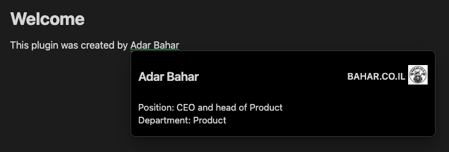

# Obsidian People Metadata

I built People Metadata to make names in my Obsidian notes more useful. It shows people, companies, roles, and other details without leaving the note.



## Key features

- **Details on hover.** Move the pointer over a name to see the person's details.
- **People and companies.** Store people in plain Markdown files, grouped by company.
- **Company colors and logos.** Each company can have a color and a logo. If a logo does not load, the plugin shows initials.
- **Add a person form.** Add people through a form. You do not need to write the metadata by hand.
- **Automatic setup.** The plugin creates the People folder when it is missing, and it adds a template to new files.
- **Metadata context.** Limit a note to the metadata files that you choose.
- **Desktop and mobile.** The plugin is not limited to desktop Obsidian.

## Installation

The plugin is not yet in the Obsidian Community Plugins directory. Install it manually.

Requirements: Obsidian 1.5.12 or later.

1. Open the [latest release](https://github.com/AdarBahar/Obsidian-people-data/releases/latest).
2. Download `main.js`, `manifest.json`, and `styles.css`.
3. In your vault, create the folder `.obsidian/plugins/people-metadata/`. Copy the three files into it.
4. In Obsidian, open **Settings → Community plugins**. If the plugin list is locked, enable community plugins first.
5. Enable **People Metadata** in the list of installed plugins.

## Quick example

This example uses fictional people.

1. Run the **Add a person** command.
2. Enter the details. Set the full name to `Maya Lopez`, the job title to `Product Lead`, the department to `Operations`, and the description to `Owns the autumn launch plan.` In **Choose company**, select **Create a new company**.
3. Select **Save**. The plugin creates `Lopez-Company.md` in the People folder, with Maya Lopez in it.
4. In another note, type `Maya Lopez`. The plugin underlines the name.
5. Move the pointer over the name. The preview shows the details of Maya Lopez.

## How metadata works

The plugin stores people in plain Markdown files in the People folder. Each file is a note in your vault. There are two file types:

- **Consolidated:** one company, with many people. The file name is the company name.
- **Atomic:** one person in each file.

The `def-type` property sets the file type. This is a short consolidated file:

```markdown
---
def-type: consolidated
color: "blue"
---

# Maya Lopez
Position: Product Lead
Department: Operations

Owns the autumn launch plan.
```

For the full rules, the template, the color names, the logo fallback, and metadata context, see [Metadata format](documentation/METADATA_FORMAT.md).

## Settings and advanced features

In **Settings → People Metadata**, you can set:

- **People folder.** You can also right-click a folder in the file explorer and select **Set as people folder**.
- **Auto-register new files.** Adds the template to new files in the People folder.
- **Default people file type.** The type for files that have no `def-type` property.
- **Popover settings.** The trigger, the dismiss behavior, the size and the background color of the hover preview.
- **Divider.** The line that separates person entries. You can use a dash (`---`) or an underscore (`___`).

The plugin adds these commands. You can assign hotkeys to them:

- **Add a person** opens the form.
- **Preview person under cursor** shows the preview for the name under the cursor.
- **Refresh people** reads the metadata files again.

Right-click an underlined name to see these options:

- **Go to definition** opens the person's entry.
- **Edit definition** opens the entry for editing.
- **Add a person** opens the form.

## Troubleshooting

### The plugin does not work

1. Set the People folder. Right-click a folder and select **Set as people folder**.
2. Run **Refresh people**.
3. Check that each metadata file has the correct `def-type` property.

### A name is not detected

1. Check that the `# Name` line matches the name in your note. The match ignores upper and lower case.
2. Run **Refresh people**.
3. Check that the file is in the People folder.

### Company colors do not show

1. Check the `color` property in the frontmatter of the company file.
2. Use a color name or a hex code. The [metadata format](documentation/METADATA_FORMAT.md#available-color-names) page lists the names.
3. Run **Refresh people**.

## Documentation, feedback, and contributions

- [Metadata format](documentation/METADATA_FORMAT.md): the full rules, templates and edge cases.
- [Color guide](documentation/COMPANY_COLORS.md): every color name, with a preview.
- [Issues](https://github.com/AdarBahar/Obsidian-people-data/issues): report bugs or request features.
- [Discussions](https://github.com/AdarBahar/Obsidian-people-data/discussions): ask questions and share ideas.

I welcome feedback. If you find a bug or have an idea, open an issue.

To contribute code:

1. Fork the repository.
2. Create a feature branch.
3. Make your changes.
4. Open a pull request.

For a major change, open an issue first to discuss it.

## License and acknowledgments

People Metadata is licensed under the MIT License. See [LICENSE](LICENSE).

Built for the [Obsidian](https://obsidian.md) community. It comes from the need for better people and company management in personal knowledge bases.
